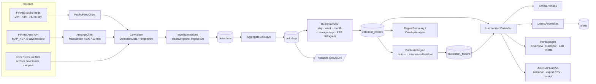
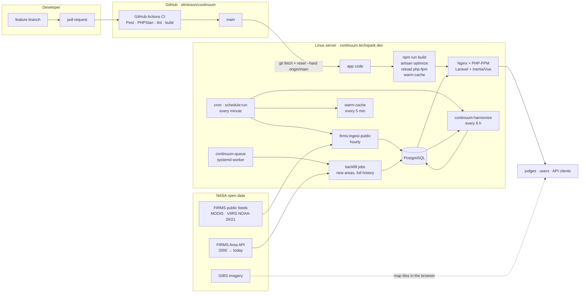

# Architecture

## Domain code

```
app/
├── Actions/
│   ├── Ingestion/
│   │   ├── ImportFirmsFile.php       # one CSV/CSV.GZ → IngestRun + detections
│   │   ├── IngestDetections.php      # batched insertOrIgnore on fingerprint (1000 rows/chunk)
│   │   └── PurgeNearRealTime.php     # drop NRT/URT/RT rows (+ cell-days) before an SP backfill
│   └── Harmonization/
│       ├── AggregateCellDays.php     # detections → cell_days (cell, day, satellite)
│       ├── BuildCalendar.php         # cell_days → calendar_entries (period, instrument)
│       ├── CalibrateRegion.php       # ratio + FRP-threshold factors with holdout validation
│       ├── DetectAnomalies.php       # robust z-scores → alerts
│       └── HarmonizeRegion.php       # BuildCalendar ×3 periods → Calibrate → Anomalies (week, month)
├── Console/Commands/                 # firms:import, firms:ingest-public, firms:backfill, continuum:harmonize, continuum:demo
├── Data/                             # DetectionData (parsed pixel + fingerprint), IngestSummary
├── Enums/                            # Instrument, Satellite, FirmsSource, PublicFeed, FeedWindow, ConfidenceClass,
│                                     # DayNight, HarmonizationMethod, ReferenceSensor, CalendarPeriod, IngestStatus, AlertSeverity
├── Exceptions/FirmsException.php
├── Http/
│   ├── Controllers/                  # Dashboard, Region (CRUD), Calendar, Lab, Alert, Method, ApiDocs (Inertia)
│   ├── Controllers/Api/V1/           # Region, Calendar, Calibration, Alert, CriticalPeriod, Export, Detection (JSON)
│   ├── Requests/                     # CalendarQueryRequest, DetectionQueryRequest, Store/UpdateRegionRequest
│   └── Resources/                    # RegionResource, CalibrationFactorResource, AlertResource
├── Jobs/                             # IngestPublicFeedJob, BackfillRegionWindowJob, HarmonizeRegionJob
├── Models/                           # Region, IngestRun, Detection, CellDay, CalendarEntry, CalibrationFactor, Alert
├── Policies/RegionPolicy.php         # presets are public; private areas are owner-only
├── Services/
│   ├── Firms/                        # CsvParser, PublicFeedClient (key-free feeds), AreaApiClient (MAP_KEY, rate limited)
│   ├── Harmonization/                # HarmonizedCalendar, CriticalPeriods, MethodReceipt
│   └── Insights/                     # RegionSummary (cards, global KPIs), OverlapAnalysis (Lab diagnostics)
└── Support/
    ├── Db/PeriodExpression.php       # date_trunc equivalents for pgsql / sqlite / mysql
    ├── Geo/                          # Grid (equal-area 1 km cells), LatLonGrid (0.25°), BoundingBox
    └── Stats/                        # Statistics (median, quantiles, MAD, bootstrap, errors), FrpHistogram
```

Frontend: `resources/js/pages/{Dashboard,Alerts,Method,ApiDocs}.vue`, `resources/js/pages/regions/{Index,Show,Lab,Form}.vue`, components in `resources/js/components/continuum/` (FireMap on MapLibre GL, HarmonizedSeriesChart / CalendarHeatmap / OverlapScatterChart / ThresholdCurveChart / DetectionCurveChart on ECharts, SeasonBar, FactorTable, ReceiptPanel, RegionCard, AlertList). Routes are typed through Laravel Wayfinder (`resources/js/routes`, generated).

## Data flow



1. **Parse.** `CsvParser` streams plain or gzip CSV, detects the instrument from the header (`bright_ti4` ⇒ VIIRS), maps satellite codes and confidence, drops `type ≠ 0` rows, optionally clips to a bounding box, and yields `DetectionData`.
2. **Ingest.** `IngestDetections` computes `cell_id` (1 km grid) and `calendar_cell_id` (0.25°) per pixel and writes chunks of 1000 with `insertOrIgnore` keyed on `fingerprint = md5(satellite | acquired minute | lat | lon)`. Re-importing overlapping feeds is idempotent; every import is recorded as an `ingest_runs` row with counts and date range.
3. **Aggregate.** `AggregateCellDays` groups detections per day into `cell_days` (upsert on `cell_id, acq_date, satellite`).
4. **Calendar.** `BuildCalendar` runs per region and period: a subquery merges satellites per instrument cell-day (sum detections, max FRP), the outer query groups by `date_trunc(period)`; a second query bins cell-day FRP with the `FrpHistogram::SQL_BIN_CASE` expression; a third counts global coverage days per instrument and period. Entries for the region/period are replaced in one transaction.
5. **Calibrate.** `CalibrateRegion` reads daily entries with coverage on both instruments since 2012-01-20, splits an interleaved holdout, fits and validates both methods, refits on all days, and replaces the region's `calibration_factors`.
6. **Derive.** `HarmonizedCalendar` combines entries and factors on request (no stored harmonized values, so a recalibration never needs a rebuild). `CriticalPeriods` and `DetectAnomalies` consume that series; anomalies are persisted as `alerts`.
7. **Serve.** Inertia controllers pass series, factors, alerts and a deferred `MethodReceipt` to Vue pages; the API returns the same structures as JSON, plus a CSV export and GeoJSON hotspots straight from `cell_days` (or `detections` with `raw=1`).

## Database

| Table                 | Key columns                                                                                                                                                                                                                                                                              | Unique / indexes                                                                                                                           |
| --------------------- | ---------------------------------------------------------------------------------------------------------------------------------------------------------------------------------------------------------------------------------------------------------------------------------------- | ------------------------------------------------------------------------------------------------------------------------------------------ |
| `regions`             | `user_id` (nullable), `name`, `slug`, `description`, `west/south/east/north` decimal(9,6), `color`, `is_preset`, `harmonized_at`                                                                                                                                                         | unique `slug`                                                                                                                              |
| `ingest_runs`         | `source`, `instrument`, `region_id`, `status`, `started_at/finished_at`, `rows_read/inserted/skipped`, `date_from/to`, `meta` json, `error`                                                                                                                                              | index (`status`, `started_at`)                                                                                                             |
| `detections`          | `fingerprint` char(32), `ingest_run_id`, `instrument`, `satellite`, `acquired_at`, `acq_date`, `latitude/longitude`, `brightness`, `brightness_secondary`, `scan`, `track`, `footprint_km2`, `frp`, `confidence_raw`, `confidence`, `daynight`, `version`, `cell_id`, `calendar_cell_id` | unique `fingerprint`; indexes (`acq_date`,`instrument`), (`cell_id`,`acq_date`), (`latitude`,`longitude`), (`calendar_cell_id`,`acq_date`) |
| `cell_days`           | `cell_id`, `acq_date`, `satellite`, `instrument`, `calendar_cell_id`, centroid `latitude/longitude`, `detections`, `day/night_detections`, `low/nominal/high_confidence`, `frp_sum`, `frp_max`, `footprint_km2`                                                                          | unique (`cell_id`,`acq_date`,`satellite`); indexes (`acq_date`,`instrument`), (`latitude`,`longitude`)                                     |
| `calendar_entries`    | `region_id`, `period`, `period_start`, `instrument`, `detections`, `active_cells`, `cell_days`, `frp_sum`, `frp_max`, `footprint_km2`, day/night and confidence counts, `active_days`, `coverage_days`, `frp_histogram` json                                                             | unique (`region_id`,`period`,`period_start`,`instrument`)                                                                                  |
| `calibration_factors` | `region_id`, `method`, `reference`, `month` (0 = all-year), `metric`, `value`, `ci_low`, `ci_high`, `sample_days`, `overlap_from/to`, `validation` json, `version`, `calibrated_at`                                                                                                      | unique (`region_id`,`method`,`reference`,`month`,`metric`)                                                                                 |
| `alerts`              | `region_id`, `period`, `period_start`, `metric`, `method`, `reference`, `observed`, `expected`, `spread`, `z_score`, `percentile`, `severity`, `climatology_years`, `message`                                                                                                            | unique (`region_id`,`period`,`period_start`,`metric`,`method`,`reference`); index (`severity`,`period_start`)                              |

Plus the framework tables (users, sessions, cache, jobs, job_batches, failed_jobs, passkeys). PostgreSQL is the target; the period truncation SQL also has SQLite and MySQL variants.

## Jobs, queues, scheduler

| Job                                                     | Trigger                                                                                                                                                  | Attributes                                                            |
| ------------------------------------------------------- | -------------------------------------------------------------------------------------------------------------------------------------------------------- | --------------------------------------------------------------------- |
| `IngestPublicFeedJob(feed, window, bbox?)`              | `firms:ingest-public --queue`                                                                                                                            | `#[Tries(3)] #[Backoff(120)] #[Timeout(1800)]`                        |
| `BackfillRegionWindowJob(regionId, source, from, days)` | `firms:backfill` (one per 5-day window and source, dispatched as a `Bus::batch` named `backfill:{slug}`; purges NRT rows first when the source is `_SP`) | `Batchable`, `#[Tries(5)] #[Backoff([60, 300, 900])] #[Timeout(600)]` |
| `HarmonizeRegionJob(regionId, aggregate = true)`        | region created / box changed / "Re-run" button, and `finally` of a backfill batch                                                                        | `ShouldBeUnique` per region, `#[Tries(2)] #[Timeout(3600)]`           |

`routes/console.php` schedules, all `withoutOverlapping` and `onOneServer`:

| Command | Production schedule (UTC) |
| --- | --- |
| `firms:ingest-public --presets --window=24h` | every hour at :05 |
| `continuum:harmonize --from=<3 days ago>` | `25 */6 * * *` (`CONTINUUM_HARMONIZE_CRON`) |
| `continuum:warm-cache` | every 5 minutes |
| `continuum:triage-alerts` | every hour at :50 |

The public API is throttled at 120 requests/minute per user id or IP (`AppServiceProvider`). Cache and queue use the `database` driver by default; Redis is a drop-in via `.env`.

## Deployment and data refresh



1. **Ship.** Every change goes through a pull request; CI runs the tests, static analysis, lint and a frontend build. Only `main` is deployed.
2. **Deploy.** The server resets its checkout to `origin/main`. Then `npm run build` if the frontend changed, `artisan optimize`, a PHP-FPM reload and `continuum:warm-cache`, so the first visitor never waits for cold aggregates.
3. **Refresh.** Cron runs the Laravel scheduler every minute. It pulls the last 24 h of FIRMS public feeds each hour (fingerprints make overlapping pulls idempotent), re-harmonizes the last three days every six hours, and keeps the dashboard cache warm.
4. **Backfill.** A new area queues one job per 5-day window and source against the FIRMS Area API. The systemd queue worker runs them, then harmonizes the area.
5. **Serve.** Pages and the JSON API read from PostgreSQL. NASA GIBS tiles load straight into the visitor's browser under the fire maps.

## Authorization

`RegionPolicy`: anyone can view presets; private areas are visible, editable and deletable only by their owner; presets are never editable. Public pages and the API therefore need no login; creating an area does.
